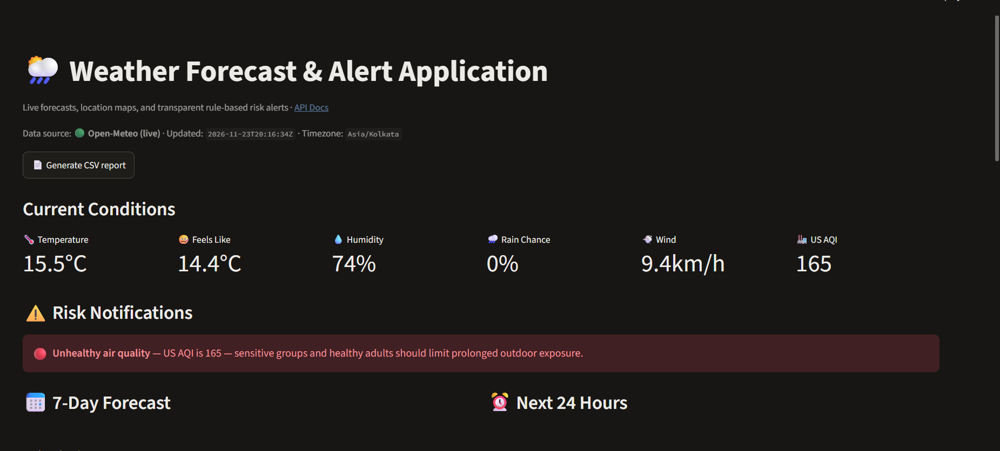

# Weather Forecast and Alert Application

An enterprise-ready, modular Python web service and interactive dashboard that delivers real-time weather forecasting, location geocoding, rule-based environmental risk analysis, and offline scenario simulations.

The system uses public weather endpoints provided by Open-Meteo, requiring no proprietary API keys or paid tiers for baseline operations. It provides both a RESTful backend API powered by FastAPI and a web presentation layer built with Streamlit.

---

## Visual Overview



*Figure 1: Streamlit Dashboard displaying current conditions, alert notifications, 7-day forecast trends, 24-hour progression, and geographical location mapping.*

---

## Executive Summary

The Weather Forecast and Alert Application addresses the need for accessible, reliable meteorological monitoring without vendor lock-in. Key capabilities include:

1. Real-Time Meteorological Intelligence: Automated city geocoding, current observation capture, 24-hour hourly progressions, and 7-day daily forecasts.
2. Deterministic Risk Evaluation Engine: A rule-based alert system assessing rain probability, precipitation volume, heat stress, relative humidity, wind velocity, air quality (US AQI), and WMO thunderstorm classifications.
3. Air Quality Index Integration: Concurrent asynchronous querying of US AQI readings mapped to the active observation hour.
4. Resilient Offline Simulation: High-fidelity, deterministic demo scenarios for 5 global metropolitan hubs (New Delhi, London, Tokyo, New York, Sydney), allowing complete offline demonstrations and automated test runs.
5. Analytical Export Capabilities: On-demand generation and streaming of timestamped, tidy-format CSV audit reports.
6. Modern Dual-Tier Architecture: Decoupled service design featuring an asynchronous FastAPI backend and a Streamlit visualization frontend.

---

## System Architecture

```text
+-------------------------------------------------------------------------+
|                        Browser Client Interface                         |
+------------------------------------+------------------------------------+
                                     | HTTP Requests (Port 8501)
                                     v
+-------------------------------------------------------------------------+
|                  Presentation Layer: Streamlit Dashboard                |
|  - Real-time weather search and simulation controls                     |
|  - KPI metric cards (temperature, apparent heat, humidity, wind, AQI)   |
|  - Interactive Plotly daily and hourly visualization charts             |
|  - Natural Earth geospatial map projection                              |
|  - CSV report generation and download trigger                           |
+------------------------------------+------------------------------------+
                                     | HTTP REST Calls (Port 8000)
                                     v
+-------------------------------------------------------------------------+
|                   API Gateway Layer: FastAPI Backend                    |
|  - Endpoint routing: /health, /locations, /thresholds, /weather, report |
|  - Pydantic query validation and HTTP status translation                |
|  - In-memory process cache with configurable Time-To-Live (TTL)         |
+-----------------+-------------------------------------+-----------------+
                  |                                     |
                  | simulation=false                    | simulation=true
                  v                                     v
+-----------------------------------+ +-----------------------------------+
|         Live Service Layer        | |     Deterministic Simulation      |
|  - Asynchronous HTTPX client      | |  - 5 hardcoded scenario profiles  |
|  - Open-Meteo Geocoding Search    | |  - Mathematical hourly variation  |
|  - Concurrent Forecast & AQI fetch| |  - No external network dependency |
|  - Current-hour timestamp matching| |  - Transparent simulation tagging |
+-----------------+-----------------+ +-----------------+-----------------+
                  |                                     |
                  +------------------+------------------+
                                     | Normalized Weather Object
                                     v
+-------------------------------------------------------------------------+
|                       Rule-Based Alert Engine                           |
|  - Evaluates current metrics against educational risk boundaries        |
|  - 7 discrete rules: rain, volume, heat, humidity, wind, AQI, storms   |
|  - Emits structured alert objects with severity levels (high/mod/info)  |
+-------------------------------------------------------------------------+
```

---

## Directory Structure

```text
Weather-Forecast-Alert-Application/
├── data/                    Sample data and offline fixture notes
├── docs/                    Extended architectural guides and interview materials
├── images/                  User interface screenshots and visual artifacts
│   ├── .gitkeep             Preserves directory structure in source control
│   └── README.md            Instructions for visual artifact capture
├── outputs/                 Locally exported CSV snapshot files
│   └── README.md            Data retention and export governance guidelines
├── reports/                 Report documentation and future persistence templates
├── src/                     Core application source code
│   ├── dashboard/           Streamlit dashboard implementation
│   │   └── streamlit_app.py Interactive dashboard application
│   └── weather_app/         Backend API service
│       ├── __init__.py      Package initialization
│       ├── alerts.py        Rule-based alert evaluation engine
│       ├── config.py        Pydantic settings and environment management
│       ├── main.py          FastAPI route declarations and error handlers
│       └── service.py       Geocoding, network fetching, normalization, and CSV logic
├── TECHNICAL_DOCS/          Comprehensive technical documentation index (15 files)
├── .env.example             Sanitized environment variable template
├── .gitignore               Exclusion list for credentials, environments, and caches
├── main.py                  Root ASGI entry point for Uvicorn
├── README.md                Primary project documentation
└── requirements.txt         Pinned dependency specifications
```

---

## Technology Stack

### Backend Infrastructure
- Language: Python 3.11+ (Validated on Python 3.13)
- Web Framework: FastAPI (>=0.115, <1.0)
- ASGI Server: Uvicorn (standard distribution >=0.30, <1.0)
- HTTP Client: HTTPX (asynchronous client >=0.27, <1.0)
- Data Validation: Pydantic v2 (>=2.8, <3.0)
- Environment Management: python-dotenv (>=1.0, <2.0)

### Frontend and Visualization
- Dashboard Framework: Streamlit (>=1.38, <2.0)
- Charting Engine: Plotly Express (>=5.24, <7.0)
- Data Structures: Pandas (>=2.2, <3.0)
- Synchronous Requests: Requests (>=2.32, <3.0)

### External Data Providers
- Geocoding API: Open-Meteo Public Search Endpoint
- Forecast API: Open-Meteo Global Numerical Weather Prediction Model
- Air Quality API: Open-Meteo Atmospheric Chemistry Model

---

## Installation and Local Setup

### Prerequisites
- Python 3.10, 3.11, 3.12, or 3.13 installed
- Git CLI installed

### Setup on Windows (PowerShell)

1. Clone or navigate to the project directory:
   ```powershell
   cd "c:\Users\agarw\OneDrive\Desktop\New folder\python\Weather Forecast & Alert Application"
   ```

2. Create and activate a virtual environment:
   ```powershell
   python -m venv .venv
   .\.venv\Scripts\Activate.ps1
   ```

3. Install all required dependencies:
   ```powershell
   python -m pip install --upgrade pip
   python -m pip install -r requirements.txt
   ```

4. Configure local environment variables:
   ```powershell
   Copy-Item .env.example .env
   ```

5. Launch the backend API server (Terminal 1):
   ```powershell
   python -m uvicorn main:app --host 127.0.0.1 --port 8000 --reload
   ```

6. Launch the Streamlit dashboard (Terminal 2):
   ```powershell
   .\.venv\Scripts\Activate.ps1
   python -m streamlit run src/dashboard/streamlit_app.py
   ```

### Setup on macOS and Linux (Bash)

1. Navigate to the project directory:
   ```bash
   cd Weather-Forecast-Alert-Application
   ```

2. Create and activate a virtual environment:
   ```bash
   python3 -m venv .venv
   source .venv/bin/activate
   ```

3. Install dependencies:
   ```bash
   pip install --upgrade pip
   pip install -r requirements.txt
   ```

4. Prepare the local environment file:
   ```bash
   cp .env.example .env
   ```

5. Start the backend service (Terminal 1):
   ```bash
   uvicorn main:app --host 127.0.0.1 --port 8000 --reload
   ```

6. Start the dashboard application (Terminal 2):
   ```bash
   source .venv/bin/activate
   streamlit run src/dashboard/streamlit_app.py
   ```

---

## Active Service URLs

- Streamlit Web Dashboard: http://localhost:8501
- FastAPI Interactive Swagger Documentation: http://localhost:8000/docs
- FastAPI Alternative ReDoc Documentation: http://localhost:8000/redoc
- Health Probe Endpoint: http://localhost:8000/health

---

## API Reference

The backend exposes five core HTTP endpoints:

### 1. System Health Probe
- Method: `GET`
- Path: `/health`
- Description: Verifies application liveness and version status.
- Response:
  ```json
  {
    "status": "ok",
    "service": "Weather Forecast & Alert API",
    "version": "1.0.0"
  }
  ```

### 2. Simulation Locations Roster
- Method: `GET`
- Path: `/locations`
- Description: Lists preset locations with built-in offline simulation data.
- Response:
  ```json
  {
    "locations": ["New Delhi", "London", "Tokyo", "New York", "Sydney"]
  }
  ```

### 3. Alert Threshold Constants
- Method: `GET`
- Path: `/thresholds`
- Description: Exposes the exact numerical boundaries used by the alert engine.
- Response:
  ```json
  {
    "rain_moderate_pct": 40,
    "rain_high_pct": 70,
    "rain_heavy_mm": 20,
    "temp_moderate_c": 35,
    "temp_high_c": 40,
    "humidity_moderate_pct": 85,
    "humidity_high_pct": 95,
    "wind_moderate_kmh": 40,
    "wind_high_kmh": 60,
    "aqi_moderate": 101,
    "aqi_high": 151,
    "storm_wmo_codes": [95, 96, 99],
    "note": "These are educational project defaults, not official warning thresholds."
  }
  ```

### 4. Comprehensive Weather Query
- Method: `GET`
- Path: `/weather`
- Query Parameters:
  - `city` (string, optional, default: "New Delhi"): City name to geocode.
  - `latitude` (float, optional): Direct latitude coordinate (-90.0 to 90.0).
  - `longitude` (float, optional): Direct longitude coordinate (-180.0 to 180.0).
  - `simulation` (boolean, optional, default: false): Enables deterministic offline mode.
- Description: Returns geocoded location, source label, current observation, 24 hourly points, 7 daily forecasts, and computed risk alerts.
- Error Status Codes:
  - `404`: Location search returned no matches.
  - `422`: Validation error on query parameters (e.g., latitude out of range).
  - `502`: Upstream Open-Meteo service unreachable or timed out.

### 5. CSV Audit Report Download
- Method: `GET`
- Path: `/weather/report`
- Query Parameters: Same as `/weather`.
- Description: Generates a tidy long-format CSV snapshot and streams it as a file download while writing a persistent copy to `outputs/`.

---

## Risk Evaluation Rules and Thresholds

Alerts are computed dynamically by `src/weather_app/alerts.py`. All thresholds are informational defaults designed for demonstration.

| Category | Field Name | Moderate Threshold | High Threshold | Units | Operational Context |
|---|---|---|---|---|---|
| Rain Likelihood | `precipitation_probability` | >= 40% | >= 70% | % | Flags elevated chance of precipitation. |
| Precipitation Volume | `precipitation_mm` | N/A | >= 20.0 | mm | Warns of localized pooling or reduced driving visibility. |
| Extreme Heat | `temperature_c` | >= 35.0 | >= 40.0 | Celsius | Advises hydration and limitation of strenuous activity. |
| High Humidity | `relative_humidity_percent` | >= 85% | >= 95% | % | Warns of elevated heat index and muggy air quality. |
| Wind Velocity | `wind_speed_kmh` | >= 40.0 | >= 60.0 | km/h | Advises securing loose outdoor fixtures. |
| Air Quality Index | `us_aqi` | >= 101 | >= 151 | Index | Warns sensitive groups or general public of air pollution. |
| Thunderstorm Activity | `weather_code` | N/A | Codes 95, 96, 99 | WMO Code | Triggered only upon observed thunderstorm reports. |

*Note on Meteorological Accuracy: High wind or rain alone is never classified as a thunderstorm. Thunderstorm alerts require explicit WMO present-weather codes.*

---

## Offline Simulation Engine

When `simulation=true` is requested:
- Zero external HTTP requests are made to third-party services.
- Data is deterministically generated from base profiles in `service.py`.
- The response carries `source: "simulation"` and `country: "Demo data"`.
- The user interface displays a yellow indicator noting that simulated data is active.
- Important note: Offline simulation removes external weather provider dependencies, but still requires the local FastAPI backend service running on the host machine.

---

## Application and Interface Screenshots

### Web Dashboard Interface

#### 1. Primary Dashboard View
Current conditions, alert banners, risk evaluation metrics, and primary trend visualizations.


#### 2. Extended Forecast and Metrics View
Daily temperature ranges, precipitation probabilities, and 24-hour hourly progressions.


---

### Repository and Deployment Verification

The following captures document the GitHub repository structure, commit status, and online assets:

#### Repository Header and Overview


#### Repository Structure and Technical Documentation Files


#### Root Configuration and Source Code Organization


---

## Security and Credential Management

- Secret Hygiene: No private API keys or production tokens are hardcoded anywhere in the codebase.
- Environment Variable Isolation: Local configurations are stored in `.env`, which is strictly excluded from version control via `.gitignore`.
- Template Verification: `.env.example` provides parameter names without containing active secrets.
- External Provider Requirements: Open-Meteo endpoints used in this baseline implementation require no authentication credentials.

---

## Verification and Testing Checklist

To validate application integrity locally, consult the testing instructions in [`TECHNICAL_DOCS/13_VALIDATION_CHECKLIST.md`](TECHNICAL_DOCS/13_VALIDATION_CHECKLIST.md). The checklist covers:
- Liveness probe verification
- Coordinate resolution and timezone mapping
- 24-hour current observation alignment
- Rule boundary testing across all 7 categories
- Offline simulation parity
- CSV report file formatting and schema verification

---

## License and Attribution

This project is prepared for educational and portfolio demonstration purposes. Meteorological data is provided courtesy of [Open-Meteo](https://open-meteo.com/) under non-commercial terms.
